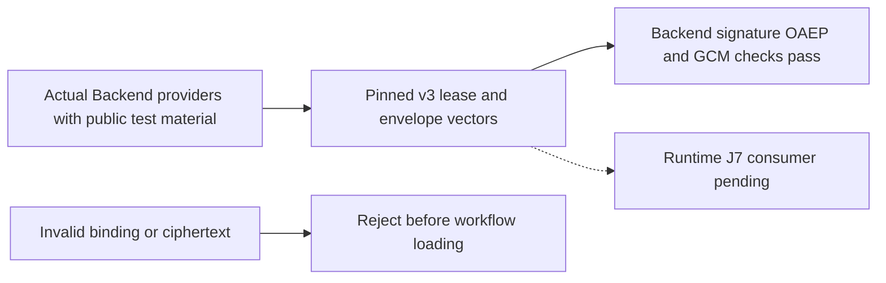

# Execution key-envelope fixtures v3

## Overview

These deliberately public, synthetic fixtures let Runtime implement key-envelope
opening without a running Backend or customer account. The actual Backend
ExecutionAuthorizationSigner and KeyService produced the current signed userId
lease and RSA-OAEP-SHA256 envelopes. Backend verifies the bytes; Runtime J7
consumption and live Product execution remain pending.



## Contents and consumer setup

- `manifest.json` pins exact `protocol-vectors.json` bytes by SHA-256:
  `87141b2bd409b53da2c971c9ee9dc2e3a2e789972592e0aaa36f50d54f143e72`.
- The fixed clock is `2026-11-27T12:00:00.000Z`. Use this clock, not today's time.
- `request`, fifteen `claims`, `authorization` and `verificationKeys` describe
  one exact execution/package/session/key. Verify the lease using J6 first;
  a binding match alone is not an authorization decision.
- `testKeys` contains the intentionally public v1 Runtime private key and Release
  content key. The test-only Backend signing key was also taken from accepted v1;
  no deployment secrets, customer records or live database are used.
- `package` retains the accepted v1 ZIP/workflow bytes and hashes, with current
  two-segment selection metadata. Current userId claims were re-signed; the
  historical v1 customerId lease is not a valid positive for current consumers.
- Eleven `cases` contain two valid randomized ciphertexts for the same K and nine
  negatives: wrong Release/session/thumbprint/algorithm, malformed Base64, wrong
  ciphertext length, corruption, wrong OAEP hash and a nonempty OAEP label.

For each OPEN case, check the exact five envelope fields against the verified
lease/session, decode canonical standard Base64 to 384 bytes, then open using
RSA-3072 OAEP/MGF1 SHA-256 with an empty label. Expect exactly the test 32-byte
content key. AES-256-GCM opening of the supplied workflow must match runtimeIrHash.
Reject every REJECT case without exposing a key/plaintext. Equivalent retries
may have different ciphertext; they preserve the same lease and content key.
The Backend test additionally rejects a different RSA private key and verifies
KeyService callback-buffer wiping after success and failure.

## Generation and verification

Backend and Plan copies have identical JSON bytes. Vendor those bytes into the
Runtime testdata directory when implementing J7; do not require a sibling repo.
Do not edit an accepted set in place or rewrite v1/v2 fixtures.

From the Backend root, verify the accepted set:

```bash
npx --no-install vitest run src/routes/execution-authorization/test/execution-authorization.envelope.spec.ts
```

The generation test is skipped by default. Explicit generation requires a **new,
nonexistent output directory** and the accepted public v1 source:

```bash
EXECUTION_AUTHORIZATION_FIXTURE_SOURCE=../a2matex-plan/components/a2matex-runtime/j_protected_execution/fixtures/v1/protocol-vectors.json \
EXECUTION_AUTHORIZATION_FIXTURE_OUTPUT=/tmp/new-execution-envelope-fixtures \
npx --no-install vitest run src/routes/execution-authorization/test/execution-authorization.envelope.spec.ts -t 'explicitly generates'
```

Generation uses synthetic test configuration and no application database or .env.
OAEP is randomized, so fresh generation changes the digest and is not a replacement
for the accepted bytes. Never install this public trust/key material in production.
These tests prove cryptographic interoperability in Node, not Runtime J7 or actual
Launcher/Backend package-execution acceptance.
